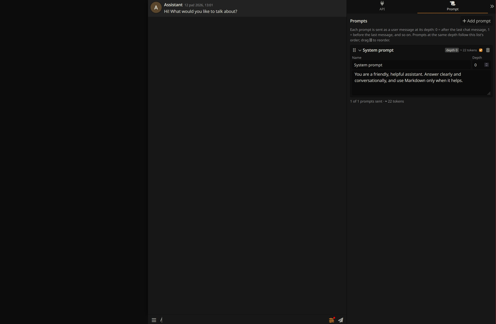

# MiniTalk

A small chat frontend for AI APIs, inspired by SillyTavern. A nice tool for quickly testing newly released LLMs. It is a single chat with a predefined assistant, a
control panel (API and Prompt tabs), and an extension loader.



## Running

```
Start.bat
```

Or run `npm install` and then `npm start`. Open http://127.0.0.1:8100/.

